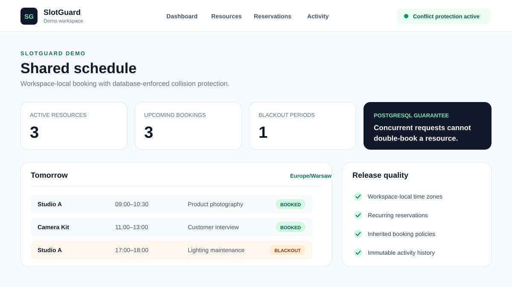

# SlotGuard

SlotGuard is a Rails application for booking shared rooms and equipment without double-booking them.

Each workspace has its own members, resources, availability, booking policies, blackout periods, recurring reservations, reminders, and activity history. PostgreSQL protects the schedule at database level, so concurrent requests cannot reserve the same resource at the same time.

## Try it

Open the GitHub Codespaces link above to launch a private browser-based copy of the project. Ruby, PostgreSQL, dependencies, and the database are prepared automatically. SlotGuard runs on forwarded port `3001`.

A GitHub account is required. Codespaces are temporary development environments and stop when left inactive.

## Local setup

    sudo service postgresql start
    mise install
    bundle install
    bin/rails db:prepare
    bin/dev

Open `http://localhost:3000`. Development emails are written to `tmp/mail`.

## Configuration

Production requires `DATABASE_URL`, `RAILS_MASTER_KEY`, `APP_HOST`, and `MAIL_FROM`. Set `SOLID_QUEUE_IN_PUMA=true` when background jobs run in the web process.

## Verification

    bin/check
